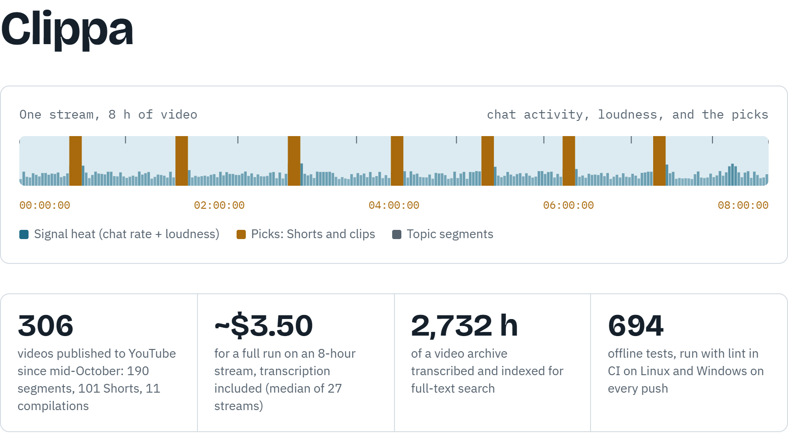

<p align="center">
  <a href="https://byvfx.github.io/clippa/">
    <picture>
      <source media="(prefers-color-scheme: dark)" srcset="docs/readme/hero-dark.png">
      
    </picture>
  </a>
</p>

[](https://ko-fi.com/byvfx)

**Clippa** turns long Kick streams into YouTube uploads: full-length segments, topic compilations,
Shorts, titles, descriptions, chapters and thumbnails, with a human review step before
anything goes out. The app was called clipper; the `clipper` command, package, config files
and containers keep that name.

**[How it works, what it costs and why it's built this way](https://byvfx.github.io/clippa/)**:
the full breakdown (the figures above are as of 11 November 2026).

```
fetch / record -> signals -> transcribe -> score -> segments -> faces -> cut -> meta -> thumbs -> shorts
                                                                                    |
                        upload <- schedule <- review (Kitsu, Discord, war room) <- review publish
```

**The docs are in the [wiki](https://github.com/byvfx/clipper/wiki)**, built from
[docs/wiki/](docs/wiki/) on every push to main. New here: [Getting started](https://github.com/byvfx/clipper/wiki/Getting-started).

## Quick start

From the clipper folder on a new machine (keep the folder path short on Windows, e.g. `C:\clipper`):

```powershell
powershell -ExecutionPolicy Bypass -File deploy\bootstrap.ps1   # macOS/Linux: bash deploy/bootstrap.sh
```

It installs uv, Python 3.12 and ffmpeg if they're missing, puts a `clipper` command on PATH,
then runs `clipper setup` and `clipper doctor`. Then, in a new terminal:

```bash
clipper fetch <kick vod url>
clipper run <stream id>
```

`clipper -h` lists the commands by group; `clipper <command> -h` gives each one's flags.

## In the repo

- `clipper/`: the package, one module per stage; `clipper/cli.py` wires them
- `docs/wiki/`: the wiki's pages (edit them here, in the same PR as the code)
- `clipper/defaults.toml`: every setting with its default, documented; `clipper.example.toml` is a starter clipper.toml
- `HANDOFF.md`: current state between work sessions; `docs/log/` has the dated diary
- `CLAUDE.md`: rules for code sessions
- `studio/`: the studio's working files (mockups, research notes, media-heavy reports); not part of the package
- `LICENSE`: MIT
