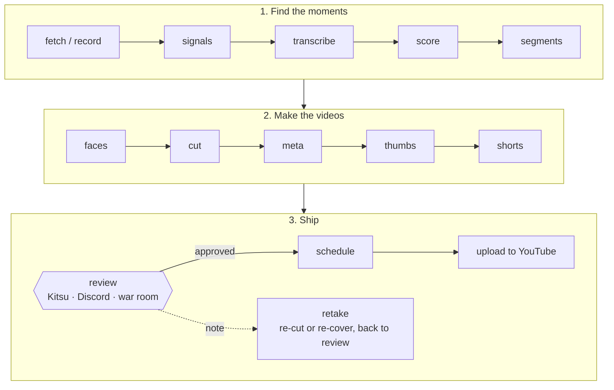

  

**Clippa** turns long Kick streams into YouTube uploads: full-length segments, topic
compilations, Shorts, titles, descriptions, chapters and thumbnails, with a person approving
every one before it goes out. Everything is a `clipper <stage>` command, and the always-on
pieces (the recorder, the worker, serve and the Discord bot) run it unattended. (The app was
called clipper; the command, package, config files and containers still are.)

> [!TIP]
> New here? Start with **[Getting started](Getting-started)**: install a machine, run one
> stream end to end, and know where to look when something breaks.

<table>
<tr>
<td width="33%" valign="top">

### Run it
[Getting started](Getting-started) 
[Roles and services](Roles-and-services) 
[Configuration](Configuration) 
[Pipeline](Pipeline) 
[Review](Review) · [Reviewing](Reviewing) · [War room](War-room) 
[Scheduling and uploads](Scheduling-and-uploads) 
[Costs](Costs) · [Checkup](Checkup)

</td>
<td width="33%" valign="top">

### Install
[Install](Install) (`clipper setup`) 
[Kitsu](Kitsu) · [Discord app](Discord-app) · [YouTube sign-in](YouTube-sign-in) 
[Windows](Install-Windows) · [macOS](Install-macOS) 
[Transcribe on Modal](Transcribe-on-Modal) 
[NAS recorder](NAS-recorder) · [NAS hub](NAS-hub) 
[Claude on the NAS](Claude-on-the-NAS) 
[Phone access](Phone-access) 
[Model providers](Model-providers) 
[Adding a show](Adding-a-show) · [YouTube channel](YouTube-channel)

</td>
<td width="33%" valign="top">

### Features
[Pre-shows](Pre-shows) and one-offs 
[Speakers](Speakers) · [Faces](Faces) 
[Covers](Covers) · [Cast library](Cast-library) · [B-roll](B-roll) 
[Weekly issue](Weekly-issue) 
[X posts](X-posts) · [TikTok](TikTok) 
[News watcher](News-watcher) 
[Character pieces](Character-pieces)

</td>
</tr>
<tr>
<td valign="top">

### Research
[Archives](Archives): other channels' back catalogs, searchable 
[People](People): one record per person, their names and channels 
[Receipts](Receipts) · [Investigations](Investigations) 
[Search swarm](Search-swarm) · [Story dossiers](Story-dossiers)

</td>
<td valign="top">

### Working on Clippa
[Developing](Developing): layout, code shape, checks, and how these pages are built 
[How the processes talk](How-the-processes-talk): locks, heartbeats, the outbox, serve's API, which log to read

</td>
<td valign="top">

### Something broke?
`clipper doctor` prints a fix for each problem; the bot DMs you; `clipper checkup` finds what
never raised an error; logs are in `logs/`
([more](Getting-started#when-something-breaks))

</td>
</tr>
</table>
