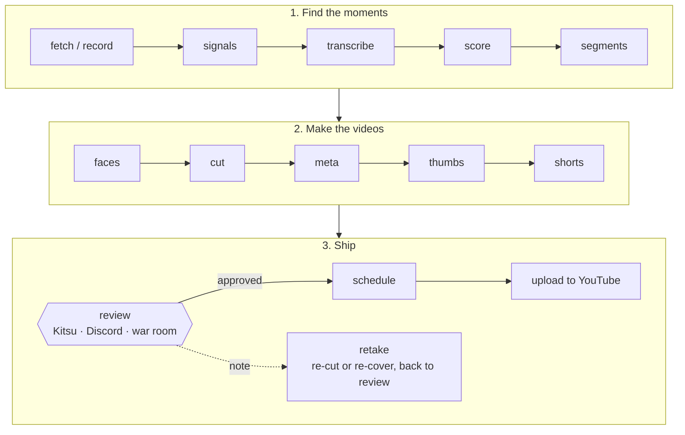

One stream in, a reviewed set of videos out:

Everything is a `clipper <stage>` subcommand working on one stream's folder, `streams/<id>/`.
Stages are idempotent: `clipper run <id>` does every stage the stream still needs, and
`clipper run <id> --from cut` runs from a stage on again (`clipper run -h` lists the stages). Four
of them are the fast lane's early versions for the picks, what the Shorts need first: `clips`,
`clips_meta`, `clips_thumbs` and `clips_review` are `cut`, `meta`, `thumbs` and `review
publish` run on the picks alone, before the slow stages do the segments and compilations.
`--only` and `--from` choose stages, not what they redo: each keeps the paid work it finds
(drafts, covers, unchanged cuts), so to redo a cover or a draft run the stage itself,
`clipper thumbs <id> --items s03 --force` or `clipper meta <id>`.

## Stages

- **fetch / record**: a finished Kick VOD, or the live stream as it happens ([NAS recorder](NAS-recorder)), with chat.
- **signals**: chat activity and loudness into a heat curve.
- **transcribe**: WhisperX (NVIDIA, or on [Modal](Transcribe-on-Modal)'s cloud GPUs) or
  mlx-whisper (Apple Silicon) to word timestamps; with `[transcribe] diarize`, speaker turns
  too, named per show by `clipper speakers` ([Speakers](Speakers)). Once a stream has names,
  the transcript the model stages read tags each turn (`[PPP] ...`, `[?]` for a voice nobody
  named, `[music]`), and the weekly credits a quote to whoever said it.
- **score**: Claude reads the transcript and heat curve and proposes moments and picks. A
  rerun pays every window again, so it refuses without `--force`.
- **segments**: Claude splits the stream into topic segments and compilations.
- **faces**: who is on screen, by face, over every keyframe (CPU, `clipper faces`): groups named
  against known faces kept for every show ([Faces](Faces)). The worker runs it after the fast
  lane, before the slow cut.
- **cut**: lossless segment cuts on keyframes, re-encoded picks, bleeps; a few segments at once,
  on the NAS beside the source with `[cut] backend = "nas"` ([NAS recorder](NAS-recorder)).
- **meta**: titles, descriptions, tags, chapters and SRT captions.
- **thumbs**: tabloid-style [covers](Covers) (a 9:16 one for each Short), with photos from the
  [cast library](Cast-library) for people talked about but not on screen.
- **shorts**: vertical captioned Shorts. With `[shorts] window = "short"` each Short is the
  pick's scored hot-take moment (15-59 s here, under YouTube's 60 s Content ID block line),
  ending on a full sentence. Picks are also cut as horizontal clips; leave `"picks"` out of
  `[review] include` to post only their Shorts. Each show's screen layouts are measured once
  ([Adding a show](Adding-a-show)).
- **review**: every item goes to Kitsu and Discord. Approve, reject, hold, or leave a note
  asking for a change. Notes become retakes: the item is re-cut or re-thumbnailed and comes
  back for review ([Review](Review), [War room](War-room)).
- **schedule / upload**: approved items get release slots and go to YouTube as private videos
  with a publish time ([Scheduling and uploads](Scheduling-and-uploads)).

Elsewhere after review: [X posts](X-posts), [TikTok](TikTok) (by hand), and `clipper rumble`,
which prepares folders for Rumble's upload form.

## Shorts from a stretch you name

`clipper pick` is for when you watched the show and know where the good bits are:
`clipper pick <stream> --from 4:05:00 --to 4:25:00 --about "the Quartering bit"` (or
`--at 4:50:00`, or only `--about`, which searches the stream's summary first; `--find <word>`
lists transcript lines for free). Times are the Kick VOD's clock. The moments found join the
stream's picks (ids `h01`...) and go through cut, meta, thumbs, Shorts and review like scored
ones; `--dry-run` shows them without saving.

## The worker

`clipper worker` runs the pipeline for each recording as it finishes. Clips and Shorts come
first (`[worker] fast_lane`): once a stream is transcribed and scored, its picks and their
Shorts are cut, written up and sent to review (roughly an hour after an 8-hour show ends), and
only then does the worker cut the long segments and compilations, which take hours. A newer
stream's clips go ahead of an older stream's segments. `clipper worker --status` shows each
recording's stages.

## What reruns cost

> [!WARNING]
> Model calls cost money. Check what a rerun of `score`, `segments`, `meta` or `thumbs` costs
> on a long stream first ([Costs](Costs)).

`score` refuses a rerun without `--force` (`clipper run --from` passes it), `cut` keeps picks
whose in/out points are unchanged, `thumbs` keeps a cover whose cut is unchanged, and
`weekly --render` never drafts.

[Pre-shows](Pre-shows) and one-off YouTube videos take a shorter path: one whole video, no
clips or Shorts.
